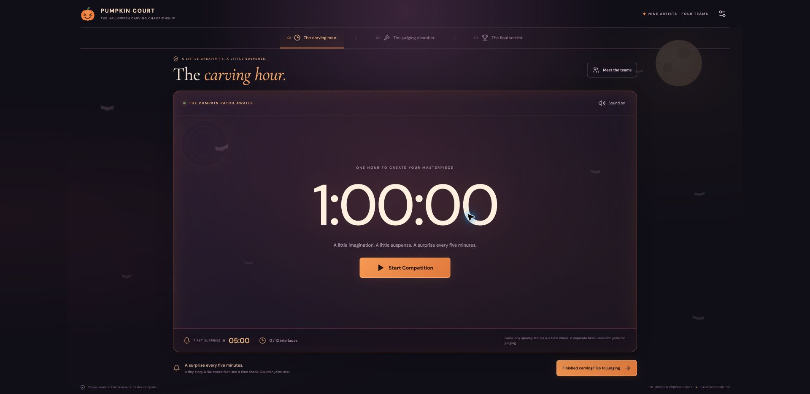
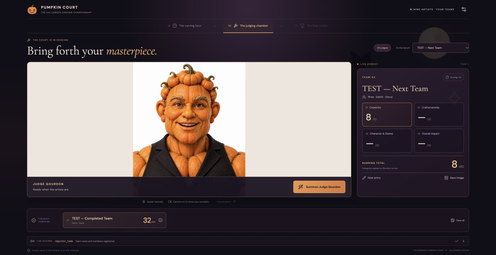
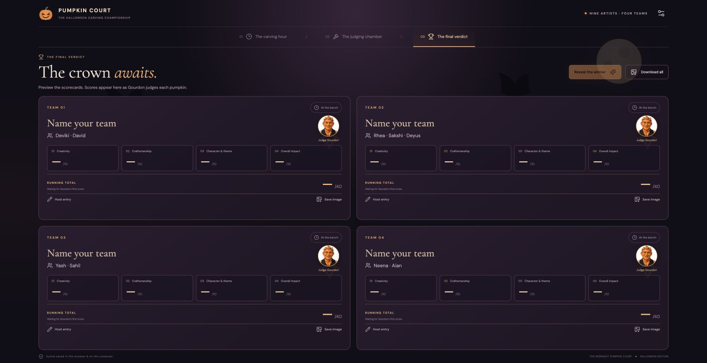
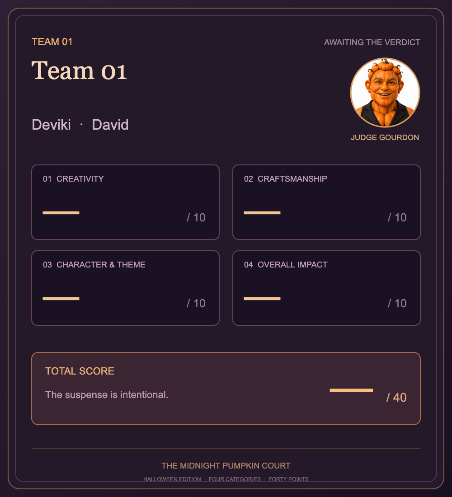

# Judge Gourdon · The Midnight Pumpkin Court

A local React app for a Halloween pumpkin-carving competition: a one-hour carving clock, natural voice announcements, a live Runway avatar judge, and scorecards you can save as images.



## Run locally

Use **Node.js 22.22 or later** and npm. A Runway developer API key and a ready custom avatar are required for live judging. The clock, included announcement audio, and scorecard previews work without starting a paid avatar session.

```sh
git clone https://github.com/sahilakos/pumpkin-judge-gourdon.git
cd pumpkin-judge-gourdon
npm ci
cp .env.example .env
```

Edit `.env` with your own values:

```dotenv
RUNWAYML_API_SECRET=your_runway_api_key_here
RUNWAY_AVATAR_ID=your_runway_avatar_id_here
# Optional: your character's full developer-dashboard URL.
RUNWAY_CHARACTER_URL=
```

Then build and start:

```sh
npm run build
npm start
```

Open **http://127.0.0.1:3000**. Stop the server with **Ctrl+C**. On macOS, after filling in `.env`, you can also double-click **Start Pumpkin Court.command**.

The Express server binds only to `127.0.0.1:3000`. No deployment is required. Credentials are read on the server; no API key or widget key is embedded in the browser bundle. `.env`, legacy `.env.local`, runtime scores, dependencies, and build output are ignored by Git. Commit only the placeholder `.env.example`.

## Competition flow

1. **The carving hour:** click **Start Competition** to begin a full hour. Every five minutes the Haunted Herald shares a short fact or story and a time reminder. Only **Pause** stops the countdown; switching app sections or browser tabs does not. Reloading preserves its deadline. The first tab has subtle bats, a moving moon, and a shifting glow, with reduced-motion support.
2. **The judging chamber:** summon Judge Gourdon when the pumpkins are ready. The microphone starts on; turn on the laptop camera to show each pumpkin. Gourdon stays inside the page frame, with speaker volume, microphone, camera, and screen-share controls. The sound check in host settings is a separate 30-second call.
3. **The final verdict:** preview all four cards at any time. The winner can be revealed after all four complete scorecards have been saved. Download one team card or a single PNG containing all four, including the judge portrait and member names.

Judge sessions last up to 20 minutes. Starting another session loads the saved teams and scores. Each call receives fresh session credentials, including a full call after a short sound check. If the browser blocks autoplay, click **Enable judge sound**.

### Live judging



*The screenshot above uses clearly labeled synthetic test scores to demonstrate the live layout.*

Gourdon updates the app through authenticated backend tool calls:

| Tool | Behavior |
| --- | --- |
| `get_contest_state` | Load the saved roster and existing assessments. |
| `register_team` | Save the team's chosen name and confirmed members; bring its card to the bench. |
| `set_category_score` | Show one category score and its reason live. |
| `save_pumpkin_score` | Validate and persist a complete scorecard. |
| `reveal_results` | Reveal the winner after all four complete assessments. |

The judge appears on the left and the current scorecard on the right. Each category is worth 10 points, for a total of 40. Registering the next team moves the previous completed card into the row below. Click the live-action bar to review tool activity. Host controls allow manual corrections.

### Results and downloaded cards



<details>
<summary>Example downloadable team card</summary>



</details>

## Teams and character knowledge

The starter roster contains nine artists:

- Team 1: Deviki and David.
- Team 2: Rhea, Sakshi, and Deyus.
- Team 3: Yash and Sahil.
- Team 4: Neena and Aian.

Teams choose their own names. Edit the roster in the host settings for another event. The character's judging personality, voice, and base knowledge should already be configured in Runway. The optional [family and team knowledge](docs/family-and-teams.md) can be uploaded to its Knowledge tab; the app also supplies the event roster, relationships, scoring tools, and saved state during a session. Adapt that event-specific context in `server/tools.ts` and the starter roster in `src/contest.ts` when reusing this app.

## Saved data

- `data/contest.json` stores the current teams and scorecards using atomic writes. It stays local and is not committed.
- Browser storage caches scorecards, tool history, the selected stage, and the carving timer.
- Scores survive server restarts; the timer survives browser reloads.
- The host desk exports/restores JSON backups and exports CSV.
- PNG downloads are rendered locally, with the judge portrait loaded before export.

## Announcement audio

Thirteen prerecorded MP3s are included in `public/herald`: the opening announcement and all twelve five-minute interludes. They were generated through Runway text to speech using the ElevenLabs multilingual model and the Bernard preset. Playback is local, so there is no generation wait during the competition. Browser speech is a fallback if a clip cannot load.

To regenerate missing clips using your own Runway account:

```sh
npm run generate:herald
npm run build
```

Runway charges account credits for generation and avatar calls. Playing the included clips and running the clock do not create Runway sessions. If you change the scripts in `src/clock.ts`, remove the corresponding old clip before regenerating it.

## Development and checks

```sh
npm run dev          # Express + Vite development mode
npm test             # Timer, scoring, persistence, backup, and tie-break tests
npm run build        # TypeScript checks and production frontend build
```

For a live, billed integration check on an **unstarted, empty-name contest only**, start the local server and run:

```sh
node server/connection-check.mjs
```

This publishes the included synthetic speech fixture without recording a microphone or camera, asks the real model to exercise its tools, briefly shows synthetic scores, and restores the starting contest. Do not run it during a real competition. Regular tests and builds do not call Runway.

## Stack

React 19, TypeScript, Vite, Express, the official Runway avatar React SDK and backend RPC handler, LiveKit, browser storage, and local canvas PNG export.
